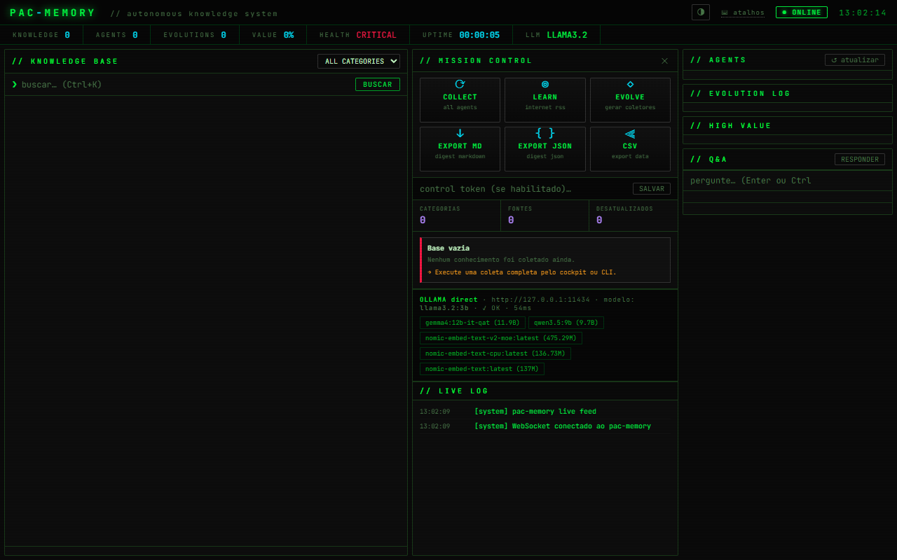
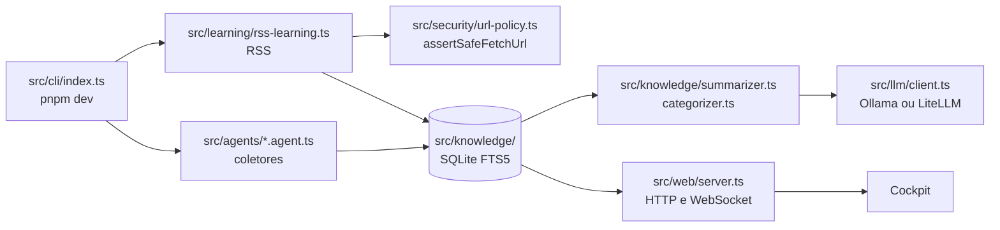

<div align="center">

# PAC-MEMORY

**Sistema de conhecimento local e autônomo, com coletores, memória full-text e cockpit operacional ao vivo.**<br/>
Coleta sinais da máquina, da rede, do ambiente, do GitHub e da web, e busca tudo em SQLite com FTS5.

[](https://www.typescriptlang.org/)
[](https://nodejs.org/)
[](package.json)

<br/>



</div>

> Autonomous Knowledge & Self-Evolution System. Para começar, rode `pnpm install` e depois `pnpm dev`, que inicia a coleta inicial, o cockpit e o servidor web.

## ✨ Por que PAC-MEMORY

Escopo pequeno: uma base de conhecimento pessoal que roda na sua máquina.

- **Local**: SQLite com busca FTS5. O LLM padrão é o Ollama em `127.0.0.1`.
- **Ao vivo**: o cockpit recebe eventos por WebSocket enquanto coletores e ciclos de aprendizado rodam.
- **Explicável**: o digest informa valor, frescor, cobertura e riscos da base.

## 🖼️ Tour

<table>
<tr>
<td width="100%"><br/><b>Cockpit</b>: estado da base, ações de coleta e aprendizado, status do LLM e log ao vivo.</td>
</tr>
</table>

TODO(screenshot): Q&A e painel de agentes com base populada, com dados fictícios.
TODO(screenshot): tema claro do cockpit.

## 🚀 Instalação

Pré-requisitos: Node.js e pnpm. A versão do pnpm está fixada em `packageManager` no `package.json`.

```bash
pnpm install                 # Instala as dependências
cp .env.example .env         # Cria o arquivo de ambiente (edite os valores necessários)
```

Para o Q&A e a sumarização, suba um LLM local. Ferramentas externas, não verificadas nesta revisão:

```bash
ollama pull llama3.1:8b
OLLAMA_API_BASE=http://127.0.0.1:11434 litellm --model ollama/llama3.1:8b --port 4000
```

## 🧭 Uso

```bash
pnpm dev              # Inicia coleta inicial, scheduler e cockpit
pnpm dev:status       # Mostra o estado da base
pnpm dev:collect      # Coleta dados
pnpm dev:learn        # Ciclo de aprendizado
pnpm dev:evolve       # Auto-evolução
pnpm dev:insights     # Gera insights
pnpm dev:export       # Exporta o digest
pnpm dev:mcp          # Servidor MCP
```

Saída real de `pnpm dev:status` numa base recém-criada:

```text
Knowledge entries: 0
```

Opções de `pnpm dev` (saída real de `pnpm dev --help`):

```text
pac-memory start
Options:
      --no-web      Disable web server                [default: false]
      --no-collect  Skip initial collection           [default: false]
```

Cockpit: `http://localhost:3000` (porta padrão, configurável por `PORT`).

## 🛠️ Funcionalidades

- **Base de conhecimento local**: SQLite com busca FTS5.
- **Coletores**: sistema, rede, ambiente, GitHub e monitoramento web.
- **Live WebSocket**: feed de eventos ao vivo no cockpit.
- **Ollama e LiteLLM**: sumarização, categorização, Q&A e auto-evolução.
- **RSS learning**: ciclo de aprendizado autônomo com proteção SSRF.
- **Paper aggregator**: coleta de artigos de IA e LLM do arXiv.
- **IA Know publishing**: geração de Markdown e JSON com git commit e push automáticos.
- **Relatórios**: digest de inteligência (valor, frescor, cobertura, riscos).
- **CLI**: comandos para coleta, aprendizado, evolução e exportação.

## ⚙️ Como funciona



- Toda URL buscada pelo aprendizado passa por `assertSafeFetchUrl` antes da requisição.
- Sumarização e categorização chamam o LLM pela mesma função (`generateTextWithFallback` em `src/llm/client.ts`).

## 🔧 Configuração

Copie `.env.example` para `.env`. Sem `.env`, o sistema usa os padrões abaixo.

| Variável | Propósito | Obrigatório ou padrão | Exemplo |
|---|---|---|---|
| `LLM_PROVIDER` | Provedor de LLM: `ollama`, `openai`, `anthropic`, `google` ou `litellm` | padrão `ollama` | `ollama` |
| `OLLAMA_BASE_URL` | URL do servidor Ollama | padrão `http://127.0.0.1:11434` | `http://127.0.0.1:11434` |
| `OLLAMA_MODEL` | Modelo do Ollama | padrão `llama3.1:8b` | `llama3.1:8b` |
| `LITELLM_BASE_URL` | URL do proxy LiteLLM | padrão `http://127.0.0.1:4000` | `http://127.0.0.1:4000` |
| `LITELLM_MODEL` | Modelo do LiteLLM | padrão `ollama/llama3.1:8b` | `ollama/llama3.1:8b` |
| `GITHUB_TOKEN` | Token da API do GitHub (coletor GitHub) | opcional | — |
| `GITHUB_USERNAME` | Usuário do GitHub (coletor GitHub) | opcional | — |
| `PORT` | Porta do cockpit | padrão `3000` | `3000` |
| `DB_PATH` | Caminho do banco SQLite | padrão `data/pac-memory.db` | `data/pac-memory.db` |
| `CONTROL_API_TOKEN` | Token das rotas de controle do cockpit | opcional; sem ele, um token aleatório por processo é gerado (não é logado) e as rotas de controle ficam inacessíveis | — |
| `IA_KNOW_REPO_URL` | Repositório git de destino do IA Know | opcional | — |
| `IA_KNOW_AUTO_PUBLISH` | Publica automaticamente após o `learn` | padrão `false` | `false` |
| `PAPER_AGGREGATOR_ENABLED` | Ativa a coleta de artigos do arXiv | padrão `true` | `true` |

Não coloque chaves reais em arquivos versionados. O `.env` é ignorado pelo git.

## 💻 Desenvolvimento

```bash
pnpm install          # Instala as dependências
pnpm dev              # Roda em modo de desenvolvimento (tsx)
pnpm dev:web          # Roda apenas o servidor web
pnpm test             # Roda os testes (Vitest)
pnpm test:watch       # Testes em modo watch
pnpm typecheck        # Checagem de tipos (tsc --noEmit)
pnpm lint             # ESLint em src/
pnpm build            # Compila com tsc e copia os arquivos públicos do web
```

## 🤝 Contribuição

As regras para agentes e contribuidores estão em [`AGENTS.md`](AGENTS.md). O modelo de pull request está em [`.github/pull_request_template.md`](.github/pull_request_template.md).

## 📚 Documentação

| Documento | Conteúdo |
|---|---|
| [`docs/ARCHITECTURE.md`](docs/ARCHITECTURE.md) | Camadas da arquitetura e fluxo entre módulos |
| [`docs/PROJECT_HEALTH.md`](docs/PROJECT_HEALTH.md) | Registro da revisão de saúde do repositório |
| [`docs/plans/pac-memory-autonomous-brain.md`](docs/plans/pac-memory-autonomous-brain.md) | Plano do cérebro autônomo e da implantação em Kubernetes |

Estrutura do repositório:

```
pac-memory/
├── src/
│   ├── cli/          # Comandos da CLI
│   ├── agents/       # Sistema de agentes e coletores
│   ├── knowledge/    # Base de conhecimento (SQLite e FTS5)
│   ├── llm/          # Integração com LLM (Ollama e LiteLLM)
│   ├── learning/     # Motor de aprendizado RSS e arXiv
│   ├── evolution/    # Auto-evolução
│   ├── mcp/          # Servidor MCP
│   ├── publishers/   # Publicação no IA Know
│   ├── daily/        # Rotinas diárias (digest)
│   ├── security/     # Política de URLs e utilitários de segurança
│   ├── web/          # Servidor e cockpit web
│   └── shared/       # Tipos e utilitários compartilhados
├── data/             # Banco SQLite (gerado em execução)
├── docs/             # Arquitetura e planos
├── prompts/          # Templates de prompt
├── scripts/          # Scripts de build e utilitários
├── tests/            # Testes
└── k8s/              # Manifestos Kubernetes
```

## 🔒 Segurança

- **SSRF**: o aprendizado valida cada URL com `src/security/url-policy.ts` antes de buscar.
- **Rotas de controle**: protegidas por `CONTROL_API_TOKEN`. Sem essa variável, o token é aleatório, não aparece no log, e as rotas de controle ficam inacessíveis.
- **Segredos**: `.env`, `data/` e bancos `*.db` estão no `.gitignore`.

## ⚠️ Limitações conhecidas

- A base começa vazia. Rode `pnpm dev:collect` ou use a ação COLLECT do cockpit antes de consultar.
- Sumarização, categorização e Q&A dependem de um provedor de LLM acessível, configurado em `LLM_PROVIDER`.
- O cockpit e as rotas de controle foram pensados para uso local. Exponha-os à rede somente com `CONTROL_API_TOKEN` definido.

## 📄 Licença

ISC, conforme o campo `license` do [`package.json`](package.json).
